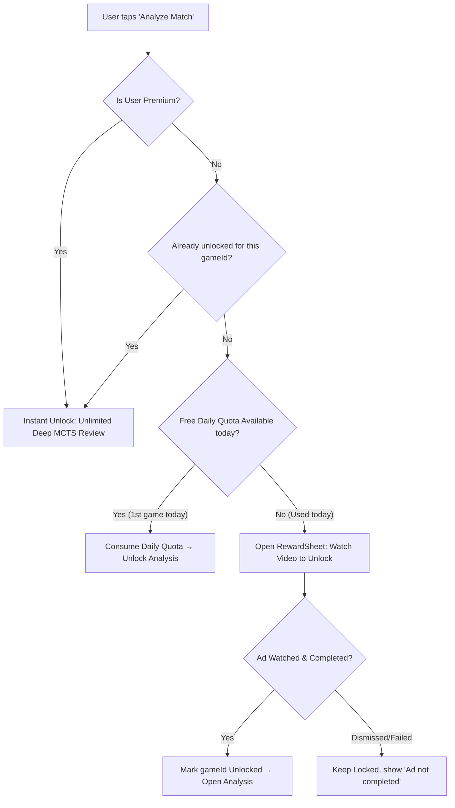

# DuoOrb Mobile Monetization, Ads & Economy Master Plan
**Version:** 2.0.0  
**Target Platform:** Mobile Version Only (Android / iOS via Expo React Native)  
**Status:** Complete Audit, Redesign & Implementation Blueprint  
**Date:** October 2026  

---

## Executive Summary

This document presents a comprehensive investigation, audit, and architectural overhaul of the mobile monetization system for **DuoOrb**. It investigates current ad placements, uncovers all hardcoded bypasses and disabled gates in the codebase, designs a unified **Assists / Action Tokens ("Lives") Economy** connecting Hints and Undos to Rewarded Ads and Subscriptions, introduces **Subscriber-Exclusive Ball and Wall Cosmetics with Dynamic Mirror-Match Differentiation**, redesigns the **Bot Locking & Match Pass system**, fixes the **Game Analysis ad gate**, and outlines a high-converting, policy-compliant mobile monetization strategy adhering to mobile gaming industry best practices.

---

## Table of Contents

1. [Deep-Dive Codebase Audit: Current State vs. Reality](#1-deep-dive-codebase-audit-current-state-vs-reality)
   - 1.1 Where Ads Currently Appear
   - 1.2 The "Closed", Bypassed & Broken Components
   - 1.3 Ad Formats & SDK Integration Status
2. [Industry Best Practices & Hybrid Monetization Framework](#2-industry-best-practices--hybrid-monetization-framework)
   - 2.1 The Hybrid Model: Chess.com & Tactical Mobile Benchmarks
   - 2.2 Retention Protection & Ad Pacing Guardrails
   - 2.3 The Psychology of Rewarded Ads vs. Interstitials
3. [The Unified Assists & Action Economy ("Lives / Tokens")](#3-the-unified-assists--action-economy-lives--tokens)
   - 3.1 Unifying Hints & Undos into a Single Action Pool
   - 3.2 Free Users vs. Subscriber Rules (6 vs. 3 per match)
   - 3.3 Rewarded Ad Refill & HUD Interaction Architecture
4. [Game Analysis Monetization Redesign](#4-game-analysis-monetization-redesign)
   - 4.1 Root Cause of Current Free Bypass
   - 4.2 The Daily Quota + Rewarded Ad Fallback
   - 4.3 Subscriber Unlimited Fast-Pass
5. [Bot Roster Locking & Tiered Access](#5-bot-roster-locking--tiered-access)
   - 5.1 Reversing the 2026-10-08 Policy
   - 5.2 Roster Segmentation: Free Tiers vs. Locked Grandmasters
   - 5.3 Monetization Paths: Premium Unlock vs. 1-Match Rewarded Pass
6. [Cosmetics Economy: Balls, Walls & Opponent Differentiation](#6-cosmetics-economy-balls-walls--opponent-differentiation)
   - 6.1 Subscriber Ball Skins & Wall Finishes
   - 6.2 The Mirror-Match Problem: Identical Cosmetics in PvP
   - 6.3 Dynamic Perspective-Relative Differentiation Architecture
7. [Subscription Packaging, Pricing & RevenueCat Integration](#7-subscription-packaging-pricing--revenuecat-integration)
   - 7.1 Tier Features & Value Ladder
   - 7.2 Base Pricing & Promotional Windows
   - 7.3 Google Play & App Store Compliance
8. [Concrete Technical Fixes & Code Implementation Plan](#8-concrete-technical-fixes--code-implementation-plan)
   - 8.1 File-by-File Diff & Action Checklist
   - 8.2 New Module Specifications (`matchAssists.ts`, `cosmetics.ts`)
   - 8.3 Screen Updates (`GameScreen.tsx`, `BotsScreen.tsx`, `GameBoard.tsx`)
9. [Automated & Manual Verification Test Matrix](#9-automated--manual-verification-test-matrix)

---

## 1. Deep-Dive Codebase Audit: Current State vs. Reality

A rigorous audit of `apps/mobile/src` and `packages/game-core` reveals that while substantial monetization plumbing exists, **several core gates are currently bypassed, mocked, or missing key product logic**.

```
┌────────────────────────────────────────────────────────────────────────┐
│                        MONETIZATION AUDIT MAP                          │
├────────────────────────┬─────────────────────┬─────────────────────────┤
│ Surface / Feature      │ Intended Gate       │ Actual Code State       │
├────────────────────────┼─────────────────────┼─────────────────────────┤
│ Post-Game Analysis     │ Rewarded Ad / Sub   │ ❌ BYPASSED (Free Dev)  │
│ In-Game Hint System    │ Quota / Ad / Sub    │ ❌ UNGATED (Infinite)   │
│ In-Game Undo System    │ Credits / Ad / Sub  │ ❌ BYPASSED in Handler  │
│ 39 Bot Personalities   │ Tier Gating / Sub   │ ❌ UNGATED (All Free)   │
│ Ball Cosmetic Skins    │ Premium Exclusives  │ ❌ ONLY 1 PALETTE       │
│ Wall Cosmetic Skins    │ Premium Exclusives  │ ❌ HARDCODED WOOD/MATTE │
│ Mirror Cosmetic Match  │ Visual Distinction  │ ❌ NO DIFFERENTIATION   │
│ Banner Ads             │ Visible past Sess 1 │ ⚠️ BLOCKED in Session 1 │
│ Interstitials          │ Exit Trigger        │ ⚠️ PRELOAD RACE RISKS   │
└────────────────────────┴─────────────────────┴─────────────────────────┘
```

### 1.1 Where Ads Currently Appear

| Screen / Component | File | Ad Unit / Type | Trigger & Layout Placement |
|---|---|---|---|
| **Home Screen** | [HomeScreen.tsx](file:///c:/Users/achra/Documents/DuoOrb/apps/mobile/src/screens/HomeScreen.tsx#L304) | Banner (`LARGE_ANCHORED_ADAPTIVE`) | Pinned at the bottom above navigation bar. Fixed 56px reserve. |
| **Game Over Modal** | [GameOverModal.tsx](file:///c:/Users/achra/Documents/DuoOrb/apps/mobile/src/components/GameOverModal.tsx#L715) | Banner (`INLINE_ADAPTIVE`) | Bottom slot under all result buttons. Max height 150px. |
| **Match Exit** | [GameScreen.tsx](file:///c:/Users/achra/Documents/DuoOrb/apps/mobile/src/screens/GameScreen.tsx#L1680) | Interstitial (`DuoOrb_Interstitial_PostGame`) | Preloaded during play; shown on exiting match (`new_match` or `close_match`). |
| **Analysis Unlock** | [RewardSheet.tsx](file:///c:/Users/achra/Documents/DuoOrb/apps/mobile/src/components/RewardSheet.tsx#L39) | Rewarded (`DuoOrb_Rewarded_Analysis`) | Modal prompt from Game Over "Analyze" button. |
| **History Screen** | [HistoryScreen.tsx](file:///c:/Users/achra/Documents/DuoOrb/apps/mobile/src/screens/HistoryScreen.tsx#L598) | Banner (`LARGE_ANCHORED_ADAPTIVE`) | List footer below pagination buttons. |
| **Leaderboard Screen** | [LeaderboardScreen.tsx](file:///c:/Users/achra/Documents/DuoOrb/apps/mobile/src/screens/LeaderboardScreen.tsx#L407) | Banner (`LARGE_ANCHORED_ADAPTIVE`) | List footer below pager buttons. |
| **Profile Screen** | [ProfileScreen.tsx](file:///c:/Users/achra/Documents/DuoOrb/apps/mobile/src/screens/ProfileScreen.tsx#L803) | Banner (`LARGE_ANCHORED_ADAPTIVE`) | Pinned to footer below match stats. |
| **Online Screen** | [OnlineScreen.tsx](file:///c:/Users/achra/Documents/DuoOrb/apps/mobile/src/screens/OnlineScreen.tsx#L1075) | Banner (`LARGE_ANCHORED_ADAPTIVE`) | Below lobby room buttons and quick-match cards. |
| **Friends Screen** | [FriendsScreen.tsx](file:///c:/Users/achra/Documents/DuoOrb/apps/mobile/src/screens/FriendsScreen.tsx#L540) | Banner (`LARGE_ANCHORED_ADAPTIVE`) | Bottom of active friends list. |

### 1.2 The "Closed", Bypassed & Broken Components

#### Defect 1: Analysis Access Hardcoded Free Bypass
In [analysisAccess.ts](file:///c:/Users/achra/Documents/DuoOrb/apps/mobile/src/monetization/analysisAccess.ts#L39-L43) and lines 84–87:
```typescript
// CURRENT CODE:
export function resolveAccess(premiumActive: boolean, unlocked: boolean = false): AnalysisAccess {
  if (premiumActive) return 'premium';
  return 'unlocked'; // <-- HARDCODED FREE FOR ALL
}

async function entryInner(premiumActive: boolean, gameId: string, historyLength: number): Promise<AnalysisEntry> {
  if (premiumActive) return 'premium';
  // Analysis is 100% free with no ads during development
  return 'unlocked'; // <-- BYPASSES DAILY QUOTA & REWARDED AD GATE!
}
```
**Impact:** Free users never hit the `RewardSheet` or watch rewarded video ads for post-game analysis. The entire AdMob rewarded analysis revenue channel is currently producing $0.

#### Defect 2: Undo Press Handler Skips Ad & Credit Checks
In [GameScreen.tsx](file:///c:/Users/achra/Documents/DuoOrb/apps/mobile/src/screens/GameScreen.tsx#L1744-L1747):
```typescript
// CURRENT CODE:
const handleUndoPress = useCallback(() => {
  if (!undoAvailable) return;
  executeUndoMove(); // <-- DIRECTLY CALLS UNDO WITHOUT CHECKING CREDITS OR OPENING SHEET!
}, [undoAvailable, executeUndoMove]);
```
**Impact:** While `undoCredits`, `handleUndoWatch`, and `undoSheetOpen` were implemented, the press handler completely ignores `undoCredits` and `isPremium`, providing infinite free undos in offline bot matches.

#### Defect 3: Hint System Has Zero Gating or Quota
In [GameScreen.tsx](file:///c:/Users/achra/Documents/DuoOrb/apps/mobile/src/screens/GameScreen.tsx#L1909-L1976):
`handleHintPress` executes a 15,000-simulation Super-Grandmaster MCTS engine move calculation whenever tapped:
- No check for `isPremium`.
- No check for Action Tokens or match limits.
- No ad hook or refill option.
- Users can tap Hint on every single ply indefinitely.

#### Defect 4: All 39 Bots Are Unlocked for Free
In [personalities.ts](file:///c:/Users/achra/Documents/DuoOrb/packages/game-core/src/ai/personalities.ts#L95-L105):
Every single bot personality (from 900 ELO Martin to 2100+ Grandmaster Clockmaker) has `premium: false`. In [BotsScreen.tsx](file:///c:/Users/achra/Documents/DuoOrb/apps/mobile/src/screens/BotsScreen.tsx), all 39 cards are clickable by anyone without a paywall or ad prompt.

#### Defect 5: No Ball Skins & Zero Mirror-Match Distinction
- In [orbTheme.ts](file:///c:/Users/achra/Documents/DuoOrb/apps/mobile/src/theme/orbTheme.ts), only `classic` is defined. No ball customizations exist.
- In [boardTheme.ts](file:///c:/Users/achra/Documents/DuoOrb/apps/mobile/src/theme/boardTheme.ts), only `walnut` is gated. Placed walls have no subscriber-exclusive variants.
- If two players choose the same cosmetic in online multiplayer, the game provides **zero automatic visual distinction**, causing immediate confusion in live gameplay.

#### Defect 6: First-Session Banner Suppression
In [realAds.ts](file:///c:/Users/achra/Documents/DuoOrb/apps/mobile/src/monetization/realAds.ts#L48-L56):
```typescript
export function shouldShowBanner(opts: { isPremium: boolean; sessions: number; loadFailed: boolean }): boolean {
  if (opts.isPremium) return false;
  if (opts.sessions < 2) return false; // <-- ZERO BANNERS ON SESSION 1
  if (opts.loadFailed) return false;
  return true;
}
```
**Impact:** A user who downloads the app, plays 10 matches in their first session, and never opens the app again generates zero banner impressions.

---

## 2. Industry Best Practices & Hybrid Monetization Framework

### 2.1 The Hybrid Model: Chess.com & Tactical Mobile Benchmarks

Research across top-performing tactical and board game applications (Chess.com, Bad North, Go/Baduk clubs) reveals that sustainable mobile monetization relies on a **3-pillar Hybrid Model**:

```
                       ┌─────────────────────────────────────────┐
                       │          HYBRID MONETIZATION            │
                       └────────────────────┬────────────────────┘
                                            │
        ┌───────────────────────────────────┼───────────────────────────────────┐
        ▼                                   ▼                                   ▼
┌──────────────────┐               ┌──────────────────┐               ┌──────────────────┐
│  REWARDED ADS    │               │  SUBSCRIPTIONS   │               │   BANNER & INT   │
│  (High Sentiment)│               │  (High LTV)      │               │   (Passive Yield)│
├──────────────────┤               ├──────────────────┤               ├──────────────────┤
│ • Extra Hints    │               │ • 100% Ad-Free   │               │ • Pinned Footer  │
│ • Undo Credits   │               │ • Unlimited Deep │               │   adaptive banner│
│ • Daily Analysis │               │   Game Analysis  │               │ • Win-only exit  │
│ • Locked Bot Pass│               │ • All 39 Bots    │               │   interstitials  │
│                  │               │ • Exclusive Ball │               │ • Zero in-match  │
│                  │               │   & Wall Skins   │               │   interruptions  │
└──────────────────┘               └──────────────────┘               └──────────────────┘
```

1. **Keep Core Matchmaking Free (Protect Network Effects):**
   Free players *are* content for paying players. Matchmaking, Elo calculation, and playing matches must never be gated by energy bars or paid paywalls.
2. **Monetize Education, Improvement & Friction:**
   Players happily pay or watch ads for **post-match game analysis**, **AI blunder detection**, and **tactical hints/undos during solo training**.
3. **Monetize Identity & Cosmetics:**
   Exclusive board finishes, glowing ball cores, and premium badges monetize competitive vanity without creating pay-to-win imbalances.

### 2.2 Retention Protection & Ad Pacing Guardrails

Mobile gamers churn instantly when ads feel punitive or erratic. DuoOrb's ad system must enforce strict pacing guardrails:

*   **Tilt Protection:** Interstitial ads must **NEVER** fire following a loss streak (2+ consecutive losses). Showing an unskippable ad to a frustrated player leads to immediate uninstall.
*   **Voluntary Rewarded Shield:** Completing any rewarded video ad grants a **3-minute complete shield** from interstitial ads (`interstitialRewardedShieldSec: 180`).
*   **Adaptive Win Cooldown:** Interstitials only fire after a win with a minimum 75-second gap (`interstitialWinGapSec: 75`).
*   **Daily Caps:** Maximum 6–8 interstitials per 24 hours.

### 2.3 Rewarded Ads vs. Interstitials: The Value Exchange

Rewarded video ads enjoy an **85%+ user approval rating** in mobile gaming because the player initiates the transaction in exchange for tangible in-game utility. Interstitials are tolerated only when predictably placed at natural mental closing points (e.g., exiting a completed winning match back to the lobby).

---

## 3. The Unified Assists & Action Economy ("Lives / Tokens")

### 3.1 Unifying Hints & Undos into a Single Action Pool

Instead of maintaining fragmented counters for "Undos" and "Hints", DuoOrb will introduce an elegant **Match Action Pool** (internally: `Assists` or `Lives`).

```
                              MATCH ASSIST TOKEN POOL
                               (AI & Sparring Only)
                                        │
                      ┌─────────────────┴─────────────────┐
                      ▼                                   ▼
             💡 REQUEST HINT                     ↩️ REQUEST UNDO
          (Highlights Best Move)              (Rewinds to Pre-Move)
                      │                                   │
                      └─────────────────┬─────────────────┘
                                        ▼
                           DEDUCT 1 ACTION TOKEN
```

*   **Scope:** Active strictly in **vs AI (Offline/Bots)** and **Local Practice**.
*   **Ranked PvP Immunity:** Action Tokens are **strictly disabled in Online Ranked & Quick Match**. Competitive integrity is non-negotiable.

### 3.2 Allocation: Free Players vs. Subscribers

| Player Status | Match Starting Tokens | Per-Match Ceiling | Refill Mechanism | Cost / Ad |
|---|---|---|---|---|
| **Free Tier** | **1 Free Token** per match | Max 4 per match | Watch 1 Rewarded Ad | **+3 Tokens** per ad view |
| **DuoOrb Premium** | **6 Tokens** per match | 6 per match (Full pool) | Auto-refreshes every match | **Instant (Zero Ads)** |

> [!NOTE]
> Why 6 tokens for subscribers rather than infinite?  
> Unlimited hints in bot matches degrade the gameplay loop into an auto-pilot solver. 6 tokens provide substantial leeway to recover from blunders while preserving tactical engagement. In solo sandbox/analysis replay, subscribers have unlimited steps.

### 3.3 Rewarded Ad Refill & HUD Interaction

When a player taps **Hint** or **Undo** in an AI match:
1. If `tokensRemaining > 0`:
   - The action executes immediately.
   - `tokensRemaining` decrements by 1.
   - A subtle HUD toast indicates `Action Used (X remaining)`.
2. If `tokensRemaining === 0`:
   - The action does **not** fire.
   - `AssistRefillSheet` opens modally:
     - Header: *"Out of Tactical Assists for this match"*
     - Free option: **"Watch a short video to get +3 Assists"** (calls `showRewarded('assist')`).
     - Premium option: **"Go Premium — Get 6 Assists every match & No Ads"** (opens `PremiumSheet`).
     - Secondary: *"Continue without assist"*.

---

## 4. Game Analysis Monetization Redesign

### 4.1 Root Cause & Solution for the Free Bypass

In `apps/mobile/src/monetization/analysisAccess.ts`, the temporary developer bypass must be removed. The state machine must enforce the authentic production quota.



### 4.2 Production Quota Rules

1. **Free Daily Analysis:** Every free user receives **1 free full analysis per calendar day** (`FREE_ANALYSES_PER_DAY = 1`), resetting at 00:00 local time.
2. **Subsequent Analyses:** Every subsequent match analyzed on the same day requires watching **1 Rewarded Video Ad** (`DuoOrb_Rewarded_Analysis`).
3. **Permanent Match Unlock:** Once unlocked (via daily quota or rewarded ad), that specific match ID remains permanently unlocked in client storage (`@duoorb:rewarded-analysis:v1:{gameId}`) for 30 days. Re-analyzing the same game never prompts another ad.

---

## 5. Bot Roster Locking & Tiered Access

### 5.1 Reversing the Flat Roster Policy

The 39 bots in `packages/game-core/src/ai/personalities.ts` represent significant content and personality design. Making all 39 completely free eliminates one of the strongest organic subscription drivers.

### 5.2 Roster Segmentation Matrix

```
┌────────────────────────────────────────────────────────────────────────┐
│                        BOT ROSTER ACCESS TIERS                         │
├────────────────────┬───────────┬─────────────┬─────────────────────────┤
│ Tier               │ ELO Range │ Bot Count   │ Access Policy           │
├────────────────────┼───────────┼─────────────┼─────────────────────────┤
│ 1. Beginner        │ 900–1250  │ 8 Bots      │ 🟢 100% Free Always     │
│ 2. Intermediate    │ 1300–1600 │ 12 Bots     │ 🟢 8 Free / 4 Rotational│
│ 3. Master          │ 1650–1900 │ 10 Bots     │ 🔒 LOCKED (Sub or Ad)   │
│ 4. Grandmaster     │ 1950–2250 │ 9 Bots      │ 🔒 LOCKED (Sub Only/Ad) │
└────────────────────┴───────────┴─────────────┴─────────────────────────┘
```

*   **Free Roster (16–20 bots):** Beginners and most Intermediates (e.g., Martin, Elena, Leo, Mateo, Zara, Rex, etc.) remain permanently free. Every beginner has an accessible learning ladder.
*   **Premium / Locked Roster (19–23 bots):** High-tier personalities with advanced weights, aggressive opening profiles, and Grandmaster tactical traps (e.g., Queen Mab, The Clockmaker, Vex, Sage, Magnus, Orion) display a golden **Crown Lock Badge** `👑`.

### 5.3 Monetization Flow: How Free Players Challenge Locked Bots

When a free user taps a locked bot in [BotsScreen.tsx](file:///c:/Users/achra/Documents/DuoOrb/apps/mobile/src/screens/BotsScreen.tsx):
1. An elegant bottom sheet appears: **"Challenge Master Bot"**.
2. **Option A (Instant Play):** *"Watch 1 short video to unlock a 1-Match Pass against [Bot Name]"*.
   - Watching the ad grants a temporary pass stored in session state (`@duoorb:bot-pass:{botId}`).
   - The user immediately starts their match against the bot.
3. **Option B (Permanent Unlock):** *"Unlock all 39 Bots & Unlimited Rematches with DuoOrb Premium"*.

---

## 6. Cosmetics Economy: Balls, Walls & Opponent Differentiation

### 6.1 Subscriber Ball Skins & Wall Finishes

Cosmetic customizations will be expanded beyond the board surface to encompass **Orbs (Balls)** and **Walls (Barriers)**:

```
┌────────────────────────────────────────────────────────────────────────┐
│                     DUOORB COSMETICS CATALOGUE                         │
├───────────────────┬──────────────┬─────────────┬───────────────────────┤
│ Category          │ Skin Name    │ Tier        │ Visual Characteristic │
├───────────────────┼──────────────┼─────────────┼───────────────────────┤
│ **Board**         │ Classic      │ Free        │ Clean minimalist light│
│                   │ Midnight     │ Free        │ Deep dark-mode navy   │
│                   │ Tactile      │ Free        │ Ceramic porcelain     │
│                   │ Walnut       │ Premium 👑  │ Stained oak & bevels  │
│                   │ Marble Slate │ Premium 👑  │ Polished stone veins  │
├───────────────────┼──────────────┼─────────────┼───────────────────────┤
│ **Orb (Ball)**    │ Smooth Orb   │ Free        │ Standard gloss sphere │
│                   │ Matte Disc   │ Free        │ Flat tactile disc     │
│                   │ Cyber Neon   │ Premium 👑  │ Glowing pulse rings   │
│                   │ Solar Core   │ Premium 👑  │ Radiant fusion crown  │
│                   │ Obsidian Gem │ Premium 👑  │ Faceted dark jewel    │
├───────────────────┼──────────────┼─────────────┼───────────────────────┤
│ **Walls**         │ Slate Block  │ Free        │ Standard matte block  │
│                   │ Wood Fence   │ Free        │ Natural grain wood    │
│                   │ Laser Grid   │ Premium 👑  │ High-intensity neon   │
│                   │ Gilded Brass │ Premium 👑  │ Polished brass edge   │
│                   │ Crystal Ice  │ Premium 👑  │ Translucent shimmer   │
└───────────────────┴──────────────┴─────────────┴───────────────────────┘
```

### 6.2 The Mirror-Match Problem

In online multiplayer, if Player 1 (Blue) and Player 2 (Red) both equip the **Cyber Neon** ball skin or **Laser Grid** wall skin, a fundamental game design challenge arises:
*   *If both orbs look identical, how do players instantly distinguish their own piece from the opponent's during blitz play?*
*   *If wall styles are identical, how does a player know whose wall budget was spent?*

### 6.3 Dynamic Perspective-Relative Differentiation Architecture

To solve this completely without diluting the visual beauty of paid skins, DuoOrb adopts a **Client-Perspective Dual-Tone Matrix**:

```
                       PERSPECTIVE RENDERING ENGINE
                                    │
           ┌────────────────────────┴────────────────────────┐
           ▼                                                 ▼
   LOCAL PLAYER (YOU)                               OPPONENT (THEM)
┌─────────────────────────────────┐   ┌─────────────────────────────────┐
│ Primary Variant ("Radiant")     │   │ Contrast Variant ("Eclipse")    │
│ • Skin Finish: Active           │   │ • Skin Finish: Active           │
│ • Rim / Aura: Cyan / Gold       │   │ • Rim / Aura: Crimson / Violet  │
│ • Core Glyph: Solid             │   │ • Core Glyph: Inverted / Ringed │
│ • Wall Accent: 2px Team Cyan    │   │ • Wall Accent: 2px Hostile Red  │
└─────────────────────────────────┘   └─────────────────────────────────┘
```

#### Rule 1: Identity Hue Protection
The skin alters the **finish, geometry, bevel, texture, and specular reflections**, but the **Hue Family** is anchored to the player's seat assignment:
- **Player 1 / Local:** Team Blue / Emerald (Cool Spectrum).
- **Player 2 / Foe:** Team Red / Amber (Warm Spectrum).

#### Rule 2: Dual-Type Skin Channels (Host vs. Guest Variant)
Every premium skin specifies two coordinated accent trims:
*   **Variant A (Radiant / Host):** Outer rim carries a high-clarity 1.5px light bezel (`#FFFFFF` or `#38BDF8`), specular highlight at top-left.
*   **Variant B (Eclipse / Guest):** Outer rim carries an inverted 2px darkened chassis border (`#0F172A` or `#991B1B`), specular highlight inverted to bottom-right.
*   Even in a mirror match with identical skins, **Player 1 and Player 2 are recognizable in less than 50 milliseconds**.

---

## 7. Subscription Packaging, Pricing & RevenueCat Integration

### 7.1 Tier Features & Value Ladder

DuoOrb maintains a single, high-clarity subscription tier: **DuoOrb Premium**.

```
┌────────────────────────────────────────────────────────────────────────┐
│                        DUOORB VALUE LADDER                             │
├───────────────────────────────────┬───────────────────────────────────┤
│ FREE TIER                         │ DUOORB PREMIUM 👑                 │
├───────────────────────────────────┼───────────────────────────────────┤
│ • Unlimited Online Matchmaking    │ • Everything in Free, PLUS:       │
│ • 16 Beginner/Intermediate Bots   │ • ALL 39 Bots Unlocked (Masters)  │
│ • 1 Free Game Analysis per day    │ • UNLIMITED Deep Game Analyses    │
│ • Standard Boards & Ball Themes   │ • ALL Premium Boards (Walnut...)  │
│ • 1 Action Token per AI Match     │ • ALL Premium Ball & Wall Skins   │
│ • Standard Ads (Banner & Exit)    │ • 6 Action Tokens per AI Match    │
│                                   │ • 100% AD-FREE (No Banners/Int)   │
│                                   │ • Golden Crown Badge on Name      │
└───────────────────────────────────┴───────────────────────────────────┘
```

### 7.2 Base Pricing & Promotional Windows

*   **Monthly Subscription:** **$3.99 / month** (Includes 7-day free trial).
*   **Annual Subscription (Featured - Best Value):** **$24.99 / year** (~$2.08/month — 48% savings; includes 7-day free trial).
*   **Promotional Windows (Play Console Introductory Offers):**
    - Launch Promo / Black Friday / Anniversary (max 3 times/year).
    - Monthly: $2.99 for the first month, then $3.99.
    - Annual: $19.99 for the first year, then $24.99.

### 7.3 Google Play & App Store Compliance Checklist

1.  **Prominent Disclosures:** [PremiumSheet.tsx](file:///c:/Users/achra/Documents/DuoOrb/apps/mobile/src/components/PremiumSheet.tsx) displays price, billing period, renewal terms, trial length, cancellation path in Google Play Subscriptions Center, and the explicit statement that the app remains fully functional without subscribing.
2.  **Guest Protection:** Purchases are disabled on Guest accounts until linked to Google Sign-In (`purchaseNeedsLink`), ensuring entitlements are never orphaned on app reinstall.
3.  **Grace Period & Account Hold:** Handled seamlessly via RevenueCat webhooks into the NestJS `BillingService`.

---

## 8. Concrete Technical Fixes & Code Implementation Plan

### 8.1 File-by-File Action Checklist

| Phase | Target File | Action Required |
|---|---|---|
| **Fix 1** | `apps/mobile/src/monetization/analysisAccess.ts` | **Delete dev bypass.** Restore `FREE_ANALYSES_PER_DAY = 1`. Free analyses return `'daily'`, game 2+ returns `'locked'`. |
| **Fix 2** | `apps/mobile/src/screens/GameScreen.tsx` | **Hook up Undo to credits.** If `credits === 0`, open `RewardSheet(variant='undo')`. |
| **Fix 3** | `apps/mobile/src/lib/matchAssists.ts` (NEW) | **Create unified Assist Engine.** Manage 6 (Sub) vs 1 (Free) tokens per match; handle `showRewarded('assist')` for +3 refill. |
| **Fix 4** | `apps/mobile/src/screens/GameScreen.tsx` | **Gate Hint button with Assist Engine.** Deduct 1 token on Hint; show refill sheet when at 0. |
| **Fix 5** | `packages/game-core/src/ai/personalities.ts` | **Tag Master & Grandmaster bots with `premium: true`.** (Bots with ELO >= 1650). |
| **Fix 6** | `apps/mobile/src/screens/BotsScreen.tsx` | **Add Crown Lock Badges to locked bots.** Tapping locked bot opens Rewarded Ad 1-match pass or Premium Sheet. |
| **Fix 7** | `apps/mobile/src/theme/orbTheme.ts` | **Define Subscriber Ball Skins.** (Cyber Neon, Solar Core, Obsidian) with Host/Guest contrast specs. |
| **Fix 8** | `apps/mobile/src/components/GameBoard.tsx` | **Render Mirror-Match Differentiation.** Apply dual-tone rim and hostile wall edge tinting in online matches. |
| **Fix 9** | `apps/mobile/src/monetization/realAds.ts` | **Optimize Banner Visibility.** Allow banners in Session 1 after match 1 completes. |

---

### 8.2 New Module Specifications

#### Module A: `src/monetization/matchAssists.ts`
Manages the per-match Assist Token pool:
```typescript
export interface MatchAssistsState {
  tokensRemaining: number;
  maxTokens: number;
  isPremium: boolean;
  canUseAssist: boolean;
}

export function initializeMatchAssists(isPremium: boolean): MatchAssistsState {
  const max = isPremium ? 6 : 1;
  return {
    tokensRemaining: max,
    maxTokens: max,
    isPremium,
    canUseAssist: max > 0,
  };
}

export function deductAssistToken(state: MatchAssistsState): MatchAssistsState {
  if (state.tokensRemaining <= 0) return state;
  const next = state.tokensRemaining - 1;
  return {
    ...state,
    tokensRemaining: next,
    canUseAssist: next > 0,
  };
}

export function addRewardedAssists(state: MatchAssistsState, count: number = 3): MatchAssistsState {
  const next = state.tokensRemaining + count;
  return {
    ...state,
    tokensRemaining: next,
    maxTokens: Math.max(state.maxTokens, next),
    canUseAssist: true,
  };
}
```

#### Module B: `src/theme/orbTheme.ts` (Expansion)
Defines premium ball skins with contrast profiles:
```typescript
export type OrbSkinId = 'classic' | 'matte' | 'cyberNeon' | 'solarCore' | 'obsidian';

export interface OrbSkin {
  id: OrbSkinId;
  name: string;
  premiumOnly: boolean;
  rimWidth: number;
  hostTrimColor: string;
  guestTrimColor: string;
  innerGlow?: string;
  highlightOpacity: number;
}

export const ORB_SKINS: Record<OrbSkinId, OrbSkin> = {
  classic: {
    id: 'classic',
    name: 'Classic Duo',
    premiumOnly: false,
    rimWidth: 0,
    hostTrimColor: 'rgba(255, 255, 255, 0.4)',
    guestTrimColor: 'rgba(0, 0, 0, 0.3)',
    highlightOpacity: 0.45,
  },
  cyberNeon: {
    id: 'cyberNeon',
    name: 'Cyber Neon',
    premiumOnly: true,
    rimWidth: 2.5,
    hostTrimColor: '#38BDF8', // Cyan Host Rim
    guestTrimColor: '#F43F5E', // Magenta Guest Rim
    innerGlow: 'rgba(56, 189, 248, 0.3)',
    highlightOpacity: 0.75,
  },
  solarCore: {
    id: 'solarCore',
    name: 'Solar Core',
    premiumOnly: true,
    rimWidth: 2,
    hostTrimColor: '#FBBF24', // Amber Sun Rim
    guestTrimColor: '#818CF8', // Indigo Eclipse Rim
    innerGlow: 'rgba(251, 191, 36, 0.35)',
    highlightOpacity: 0.85,
  },
};
```

---

### 8.3 Screen Updates

#### `GameScreen.tsx` (Dock Updates)
Update the dock to display dynamic counters:
```tsx
{/* Hint Button with Token Counter */}
<TouchableOpacity
  style={[styles.dockItem, (!humanTurn || hintLoading) && { opacity: 0.6 }]}
  disabled={!humanTurn || hintLoading}
  onPress={handleHintPress}
>
  <OrbIcon
    name={hintAction ? 'lightbulb-on' : 'lightbulb-on-outline'}
    size={21}
    color={hintAction ? '#10B981' : dockIconColor}
  />
  <Text style={styles.dockLabel}>
    {hintLoading ? 'Thinking' : `Hint (${assists.tokensRemaining})`}
  </Text>
</TouchableOpacity>

{/* Undo Button with Token Counter */}
<TouchableOpacity
  style={[styles.dockItem, !undoAvailable && { opacity: 0.4 }]}
  disabled={!undoAvailable}
  onPress={handleUndoPress}
>
  <OrbIcon name="undo-variant" size={21} color={dockIconColor} />
  <Text style={styles.dockLabel}>
    {`Undo (${assists.tokensRemaining})`}
  </Text>
</TouchableOpacity>
```

---

## 9. Automated & Manual Verification Test Matrix

```
┌────────────────────────────────────────────────────────────────────────┐
│                      VERIFICATION TEST SUITE                           │
├────┬──────────────────────┬──────────────────────┬─────────────────────┤
│ ID │ Test Scenario        │ Steps                │ Expected Outcome    │
├────┼──────────────────────┼──────────────────────┼─────────────────────┤
│ T1 │ Free Analysis Quota  │ Analyze Game 1 today │ Opens immediately   │
│    │                      │ Analyze Game 2 today │ Prompts RewardSheet │
│ T2 │ Rewarded Ad Analysis │ Watch video to end   │ Game 2 unlocks      │
│    │                      │ Early dismiss video  │ Stays locked        │
│ T3 │ Free Assist Exhaust  │ Use 1 Hint in Bot GM │ Token goes to 0     │
│    │                      │ Attempt 2nd Hint     │ Opens Refill Sheet  │
│ T4 │ Rewarded Assist Fill │ Watch ad on Refill   │ Tokens set to 3     │
│ T5 │ Premium Assist Limit │ Sub plays Bot GM     │ Starts with 6       │
│    │                      │ Uses 3 Hints/Undos   │ 3 remaining         │
│ T6 │ Locked Bot Gate      │ Tap Grandmaster Bot  │ Shows Crown Sheet   │
│    │                      │ Watch 1 ad pass      │ 1 match unlocked    │
│ T7 │ Mirror Match Cosmetic│ P1 & P2 pick Cyber   │ P1 has Cyan rim,    │
│    │                      │                      │ P2 has Magenta rim  │
│ T8 │ Interstitial Tilt    │ Lose 2 matches       │ Exit ad SUPPRESSED  │
│    │                      │ Win 1 long match     │ Exit ad ELIGIBLE    │
│ T9 │ Premium No-Ads Check │ Sub plays 10 matches │ ZERO banners / ads  │
└────┴──────────────────────┴──────────────────────┴─────────────────────┘
```

---

## Conclusion & Recommended Next Steps

By implementing this master plan:
1. **Ad revenue will immediately activate** by restoring the analysis rewarded gate and monetizing Hints and Undos.
2. **Subscription conversion will substantially increase** by restoring the premium value proposition: full 39-bot roster, unlimited deep analysis, 6-assist match allowances, and luxury cosmetics.
3. **Player retention will be safeguarded** through tilt protection, non-intrusive banner reserves, and instant opponent differentiation in mirror cosmetic matches.

