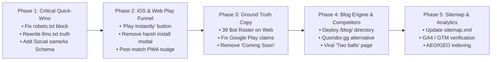

# DuoOrb: Master Execution & Sprint Roadmap

This document outlines the step-by-step phased execution plan to eliminate contradictions, revamp the iOS/Web play funnel, deploy the SEO/AEO/GEO strategy, and launch the competitor conquesting blog engine.

---

## 1. Safety & Production Integrity Guardrails

1. **Production Code Isolation**: The production Android game (`packages/game-core`, `apps/mobile/src`, `apps/server`, and Gradle build pipelines) is currently live on Google Play (v1.0.7 b20). All SEO, marketing, blog, and web landing improvements are strictly confined to `apps/mobile/public/` and targeted web client shims.
2. **Zero Breaking Changes**: We do not touch existing JNI native modules, Rust compilation targets, or backend database schemas.
3. **No Web Subscriptions**: In alignment with historical design agreements, Web/PWA remains completely free of subscription barriers. Subscriptions remain exclusively on Google Play.

---

## 2. Sprint Phases Overview

---

## 3. Detailed Phase Breakdown

### Phase 1: Critical Quick-Wins & Crawler Unblocking (Immediate)
*Goal: Remove all crawling blocks, correct AI engine knowledge, and establish social entity links.*

1. **Update `apps/mobile/public/robots.txt`**:
   - Remove `Disallow: /what-is-the-game-with-two-balls-and-walls.html`.
   - Ensure explicit `Allow: /` for `GPTBot`, `OAI-SearchBot`, `PerplexityBot`, `ClaudeBot`, `Google-Extended`, and `Applebot`.
2. **Rewrite `apps/mobile/public/llms.txt`**:
   - Declare Google Play app as **LIVE & AVAILABLE** with direct store URL.
   - Clarify iOS availability: **Instant Web/Safari Play (PWA)** with native app in development.
   - Update bot count to **39 bot personalities across 4 skill tiers**.
3. **Update `apps/mobile/public/ai-catalog.json`**:
   - Sync bot numbers and platform availability.
4. **Embed Social Accounts (`sameAs`) in JSON-LD Across All HTML Files**:
   - Add Facebook (`https://www.facebook.com/DuoOrb`), Instagram (`https://www.instagram.com/DuoOrb`), TikTok (`https://www.tiktok.com/@DuoOrb`), YouTube (`https://www.youtube.com/@DuoOrb`), and Google Play URL to the `Organization` schema.

---

### Phase 2: iOS & Web Instant Play UX Overhaul
*Goal: Transform the landing page experience for iOS and Web visitors from a frustrating install prompt into instant 0-second browser gameplay.*

1. **Revamp Hero CTA & Navigation Badges (`index.html`)**:
   - For iOS / Web / Desktop visitors: Change the primary button to **"Play Instantly"** (or for iOS: **"Play on Web / Safari"** with an instant play icon).
   - Clicking this button immediately calls `showGame()` $\rightarrow$ hides `#duoorb-home` $\rightarrow$ launches the Expo Web canvas. Zero waiting, zero modal.
2. **Smart Device Routing**:
   - If an Android user taps the Web Play or iOS trigger, detect Android and route to Google Play Store (or display a friendly banner: *"Get the high-performance native app on Google Play"*).
3. **Move PWA "Add to Home Screen" to Contextual Post-Match Nudge**:
   - Instead of aggressively popping up on initial page load, trigger the install modal only after the player has completed 1 or 2 matches in the browser.
   - Provide clean, elegant step-by-step visual instructions:
     - **Step 1:** Tap the Safari Share button ($\uparrow$ box icon).
     - **Step 2:** Tap "Add to Home Screen" ($\boxplus$ icon).
     - **Step 3:** Launch DuoOrb full-screen with offline capabilities!

---

### Phase 3: Ground Truth Copy & Feature Alignment
*Goal: Eliminate all hallucinations, outdated claims, and contradictions on the website.*

1. **Update `apps/mobile/public/index.html`**:
   - Change "20+ Offline Bots" to **"39 Smart AI Bots (800 to 2400 ELO)"**.
   - Clarify platform availability: *"Available on Google Play for Android · Play Instantly in Browser for iOS & Desktop"*.
2. **Update `apps/mobile/public/about.html`**:
   - Remove *"with native Android and iOS apps on the way"*.
   - Replace with accurate description: *"Live on Google Play for Android, with instant browser gameplay for iOS and desktop."*
3. **Update `apps/mobile/public/bots-and-analysis.html`**:
   - Expand the bot roster table from 7 bots to showcase the **39 bot personalities** across all 4 tiers (Beginner, Intermediate, Master, Grandmaster).
4. **Add Official Social Channel Icons to Website Footer**:
   - Add clean SVG icons for Facebook, Instagram, TikTok, and YouTube in the footer of all HTML pages.

---

### Phase 4: Competitor Conquesting & Blog Engine Deployment
*Goal: Capture high-intent organic searches for Quoridor, quoridor.gg, Wall Rush, and viral video searches.*

1. **Create Blog Engine Structure in `apps/mobile/public/blog/`**:
   - Lightweight, responsive CSS styling matching the main site.
   - Standardized header, footer, social links, breadcrumbs, and instant play CTA.
2. **Deploy Core Conquesting Articles**:
   - `quoridor-gg-alternative.html`: *"Quoridor.gg Alternative: Play DuoOrb with 39 AI Bots & Move Analysis"*.
   - `best-quoridor-game-mobile.html`: *"What is the Best Quoridor Game on Mobile? (Android & iOS Comparison)"*.
   - `play-quoridor-online-free.html`: *"Play Quoridor Online Free With Friends: No Ads, 6-Letter Rooms"*.
   - `wall-rush-alternative.html`: *"Wall Rush vs DuoOrb: Which Grid Strategy Game is Better?"*.
   - `games-similar-to-quoridor.html`: *"Top 7 Modern Board Games Similar to Quoridor and Blockade"*.
3. **Supercharge Viral Landing Page**:
   - Fully rewrite `what-is-the-game-with-two-balls-and-walls.html` into a rich, indexable guide with genuine gameplay diagrams, video matching signatures, and an instant playable game canvas.

---

### Phase 5: Verification, Sitemap Sync & Search Engine Submission
*Goal: Ensure perfect crawler indexation, zero 404s, and verified analytics tracking.*

1. **Update `apps/mobile/public/sitemap.xml`**:
   - Add all new blog articles with ISO 8601 `<lastmod>` dates and high priorities (`0.80`–`0.95`).
2. **Verify GA4 & GTM Event Tracking**:
   - Track `click_google_play`, `click_play_browser`, `post_game_pwa_prompt_shown`, `pwa_prompt_accepted`.
3. **Submit Sitemaps to Google Search Console & Bing Webmaster Tools**.

