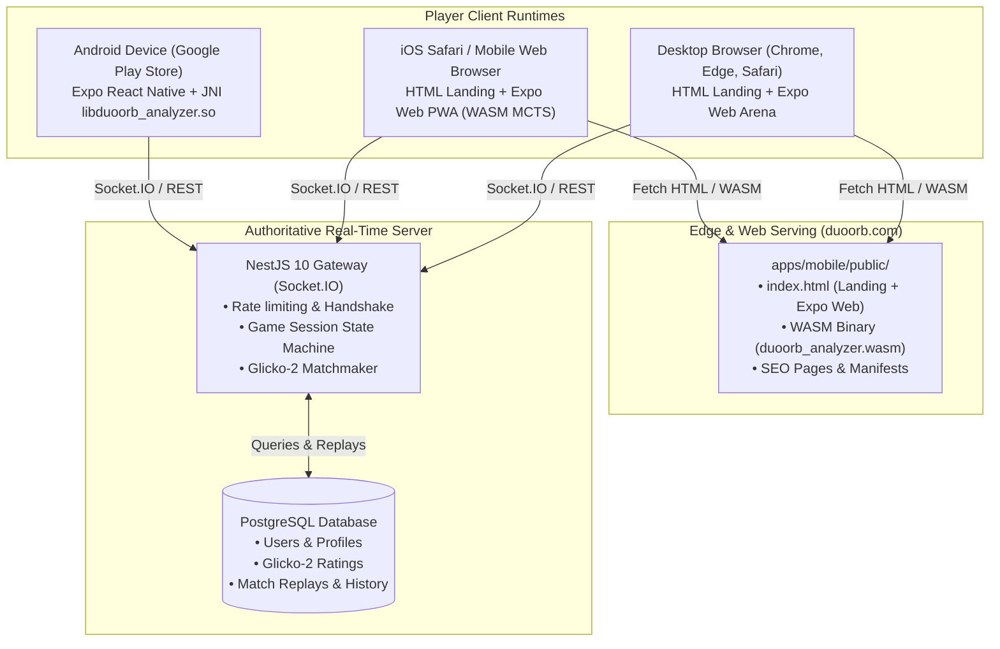

# DuoOrb: Project Tree & Architecture Blueprint

This document details the complete physical repository topology, module relationships, execution runtimes, and data flows across the entire DuoOrb codebase.

---

## 1. Monorepo Physical Directory Tree

DuoOrb is structured as an **npm workspaces** monorepo combining TypeScript, React Native (Expo SDK ~57), NestJS 10, and high-performance native Rust.

```
DuoOrb/
├── apps/
│   ├── mobile/                      # Expo SDK ~57 / React Native 0.86 Client
│   │   ├── android/                 # Bare Android project (Gradle, NDK, JNI)
│   │   ├── assets/                  # App icons, splash screens, audio fallbacks
│   │   ├── public/                  # PRODUCTION WEBSITE & PWA ROOT
│   │   │   ├── bots/                # Static bot avatar images
│   │   │   ├── css/                 # Global styles and responsive media queries
│   │   │   │   └── style.css        # Main stylesheet for duoorb.com
│   │   │   ├── fonts/               # Web font assets
│   │   │   ├── icons/               # PWA manifests and apple-touch-icons
│   │   │   ├── models/              # Pre-trained bot neural/heuristic weights
│   │   │   ├── screenshots/         # In-game authentic showcase screenshots
│   │   │   ├── about.html           # Studio identity and architecture overview
│   │   │   ├── ads.txt              # Google AdSense publisher verification
│   │   │   ├── ai-catalog.json      # Structured AI directory catalog
│   │   │   ├── app-ads.txt          # AdMob developer app-ads authorization
│   │   │   ├── app.html             # Smart Google Play redirect landing page
│   │   │   ├── bots-and-analysis.html # AI bot ladder and move analysis guide
│   │   │   ├── contact.html         # Studio contact and support form
│   │   │   ├── cookies.html         # Cookie policy & AdSense disclosure
│   │   │   ├── duoorb_analyzer.wasm # Compiled Rust MCTS engine for Web
│   │   │   ├── favicon.ico          # Browser tab favicon
│   │   │   ├── index.html           # PRIMARY LANDING PAGE + EXPO WEB HOST
│   │   │   ├── llms.txt             # Machine-readable guide for AI search engines
│   │   │   ├── manifest.json        # Web App Manifest for PWA installation
│   │   │   ├── og-image.png         # 1200x630 Open Graph preview image
│   │   │   ├── privacy.html         # Google Play compliant Privacy Policy
│   │   │   ├── robots.txt           # Search and AI crawler indexing directives
│   │   │   ├── rules.html           # Complete illustrated rules guide
│   │   │   ├── sitemap.xml          # Search engine XML sitemap
│   │   │   ├── strategy.html        # High-level tactical openings and theory
│   │   │   ├── sw.js                # PWA Service Worker (offline caching)
│   │   │   ├── terms.html           # Terms of Service
│   │   │   └── what-is-the-game-with-two-balls-and-walls.html # Viral search stub
│   │   ├── scripts/                 # Asset generators and icon formatters
│   │   ├── src/                     # React Native Client Source Code
│   │   │   ├── ai/                  # AI Web Workers and dialogue hooks
│   │   │   ├── aiwins/              # 3-star mastery bot victory tracker
│   │   │   ├── analysis/            # Move evaluation bars and graph renderers
│   │   │   ├── audio/               # Native audio bridges and sound controllers
│   │   │   ├── components/          # Reusable tactical UI components
│   │   │   │   ├── BoardView.tsx    # 9x9 tactical grid and interactive wall grooves
│   │   │   │   ├── InstallPromptModal.tsx # React Web PWA install modal
│   │   │   │   ├── MoveLog.tsx      # Algebraic move notation drawer
│   │   │   │   └── EvaluationBar.tsx # Real-time win probability bar
│   │   │   ├── i18n/                # 10-language dictionary (EN, AR, FR, DE, ES, TR, etc.)
│   │   │   ├── lib/                 # Utility helpers, share sheets, analytics
│   │   │   ├── monetization/        # RevenueCat (Play Store) & AdMob smart pacing
│   │   │   ├── network/             # Socket.IO client, reconnect logic, API client
│   │   │   ├── screens/             # Top-level screen views
│   │   │   │   ├── HomeScreen.tsx   # Hub: Play, Pass-and-Play, Bots, Online
│   │   │   │   ├── BotsScreen.tsx   # 39-bot selection ladder with 3-star mastery
│   │   │   │   ├── GameScreen.tsx   # Active game canvas, clocks, board, and undos
│   │   │   │   ├── OnlineScreen.tsx # 1v1 matchmaking, private rooms, rating
│   │   │   │   ├── MatchSetupScreen.tsx # Time control, wall budget, mode selector
│   │   │   │   ├── GameReviewScreen.tsx # Move-by-move blunder analysis
│   │   │   │   ├── HistoryScreen.tsx# Match archive and replay viewer
│   │   │   │   └── LeaderboardScreen.tsx # Global Glicko-2 leaderboard
│   │   │   ├── storage/             # AsyncStorage keys and state hydration
│   │   │   └── theme/               # Tactile design tokens, colors, typography
│   │   ├── app.json                 # Expo config (bundle ID, permissions, plugins)
│   │   ├── App.tsx                  # Root React application bootstrap
│   │   └── metro.config.js          # Metro bundler config with WASM support
│   └── server/                      # Authoritative NestJS 10 Real-Time Server
│       ├── src/
│       │   ├── auth/                # Google OAuth, guest sessions, JWT
│       │   ├── billing/             # RevenueCat webhook handler and entitlements
│       │   ├── database/            # PostgreSQL connection pool and schemas
│       │   ├── friends/             # Social friend lists and direct invites
│       │   ├── game/                # Server-authoritative game instance state
│       │   ├── gateway/             # Socket.IO gateway (`game.gateway.ts`)
│       │   ├── history/             # Game history storage and replay queries
│       │   ├── legal/               # Dynamic ads.txt and legal endpoints
│       │   ├── matchmaking/         # Glicko-2 matchmaking queue pool
│       │   ├── rating/              # Glicko-2 rating calculation engine
│       │   ├── rooms/               # 6-letter private room code orchestrator
│       │   ├── users/               # User profiles, stats, crowns, and avatars
│       │   ├── version/             # Force-upgrade and client compatibility API
│       │   ├── app.module.ts        # NestJS root application module
│       │   └── main.ts              # Server bootstrap and CORS configuration
│       └── Dockerfile               # Production container image for server
├── packages/
│   ├── game-core/                   # Universal Pure TypeScript Game Logic
│   │   ├── src/
│   │   │   ├── ai/                  # Bot engine and 39 personality profiles
│   │   │   │   ├── personalities.ts # Complete dossiers for all 39 bots
│   │   │   │   ├── engine.ts        # MCTS rollout engine in TypeScript
│   │   │   │   ├── evaluation.ts    # Board heuristic scoring
│   │   │   │   └── ranking.ts       # Bot difficulty calibration
│   │   │   ├── constants.ts         # Board dimensions (9x9), wall limits (10)
│   │   │   ├── geometry.ts          # Coordinate math, adjacent cells, grooves
│   │   │   ├── movement.ts          # Orthogonal steps and straight/diagonal jumps
│   │   │   ├── notation.ts          # Standard algebraic notation (`e2`, `v-d4`)
│   │   │   ├── pathfinding.ts       # BFS shortest path and Golden Path validator
│   │   │   ├── replay.ts            # PGN-style action serializer and deserializer
│   │   │   ├── ruleset.ts           # Authoritative state transition and rule validator
│   │   │   ├── types.ts             # Core interfaces: GameState, PlayerState, Wall
│   │   │   └── walls.ts             # Wall overlap, intersection, and boundary checks
│   │   └── package.json             # `@duoorb/game-core`
│   ├── analyzer-rust/               # High-Performance Native Rust Engine
│   │   ├── src/
│   │   │   ├── classifier.rs        # Move grading (Book, Best, Blunder, etc.)
│   │   │   ├── hints.rs             # In-game tactical move recommender
│   │   │   ├── hybrid.rs            # Blended MCTS + alpha-beta endgame solver
│   │   │   ├── mcts.rs              # 50k+ sims/s Monte Carlo Tree Search
│   │   │   ├── pathfinding.rs       # Ultra-fast bitmask / BFS pathfinder
│   │   │   ├── review.rs            # Post-match accuracy curve generator
│   │   │   └── solver.rs            # Alpha-beta minimax endgame solver
│   │   ├── Cargo.toml               # Rust dependencies (wasm-bindgen, napi, jni)
│   │   └── build.rs                 # Multi-target compilation configuration
│   └── protocol/                    # Shared Wire Protocols & DTOs
│       ├── src/
│       │   ├── events.ts            # Socket.IO client-to-server and server-to-client events
│       │   └── index.ts             # Shared network contracts
│       └── package.json             # `@duoorb/protocol`
├── modules/
│   ├── duoorb-ai-native/            # Android Expo Native Module (JNI Bridge)
│   │   └── android/                 # Loads `libduoorb_analyzer.so` on background thread
│   └── duoorb-sfx/                  # Low-Latency Native Audio Bridge
│       ├── android/                 # Android SoundPool bridge
│       └── ios/                     # iOS AVAudioPlayer bridge
├── docs/                            # Core Documentation & Runbooks
│   ├── ARCHITECTURE.md              # High-level architecture guide
│   ├── DESIGN_SYSTEM.md             # Tactile UI tokens, color palettes, fonts
│   ├── PLAY_UPLOAD.md               # Google Play Console deployment runbook
│   └── SETUP_JOURNEY.md             # Infrastructure and third-party API notes
└── plans/                           # Historic sprint roadmaps and milestone blueprints
```

---

## 2. Runtime Topology & System Interactions

The application operates across four distinct runtime contexts:



---

## 3. Detailed Data Flows

### A. Web Visitor Flow (SEO Landing $\rightarrow$ Instant Play $\rightarrow$ Optional PWA Install)
1. **Initial Visit**: User lands on `https://duoorb.com/`. The document body is rendered immediately from `apps/mobile/public/index.html`.
2. **Search Crawlers**: `Googlebot`, `Mediapartners-Google`, `GPTBot`, etc., see regular HTML document flow with headings, comparison tables, FAQ schemas, and rules.
3. **Play Instantly (Web / iOS)**:
   - When the user clicks **"Play Instantly"**, JavaScript adds `duoorb-playing` to the document body and hides `#duoorb-home`.
   - The Expo Web application mounted at `#root` renders the game canvas immediately.
   - The WebAssembly analyzer (`duoorb_analyzer.wasm`) is fetched asynchronously and instantiated via Web Workers (`apps/mobile/src/ai/aiWorker.ts`).
   - The visitor can instantly play offline against 39 bots, start local pass-and-play, or connect to the real-time server as a guest.
4. **Post-Game PWA Nudge (iOS / Web)**:
   - Only AFTER the user finishes a match, a clean, high-contrast modal offers: "Add DuoOrb to your Home Screen for a full-screen, offline-ready experience".

### B. Android Player Flow (Google Play Store)
1. User clicks Google Play links from `duoorb.com`, ads, or searches "DuoOrb" or "Quoridor" on Google Play.
2. User installs the compiled `.aab` (Bundle ID: `com.asdigital.duoorb`).
3. App launches directly into `App.tsx` $\rightarrow$ `HomeScreen.tsx`.
4. High-performance native Rust AI runs via JNI (`modules/duoorb-ai-native`), executing 50,000+ MCTS simulations/sec off the main UI thread.
5. In-app purchases (ad removal, unlimited undos) route through RevenueCat.

### C. Real-Time Multiplayer Flow
1. Client connects via Socket.IO to `apps/server` with JWT or ephemeral guest ID.
2. Matchmaking matches players based on Glicko-2 rating range (expanding every 5s).
3. Moves are validated strictly on the server using `@duoorb/game-core/ruleset`.
4. Clocks count down on the server; timeout claims are authoritative.
5. Completed matches update Glicko-2 ratings and store algebraic replay PGN strings in PostgreSQL.

