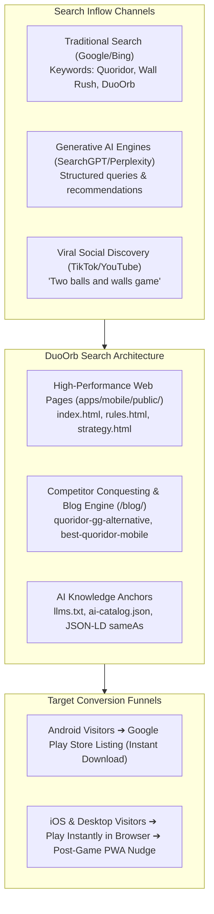

# DuoOrb: SEO, GEO & AEO Master Strategy

This document establishes the end-to-end strategic framework to dominate search engines (Google, Bing), AI answer engines (SearchGPT, Perplexity AI, Claude, Google SGE), and viral social searches (TikTok, YouTube, Instagram) for DuoOrb, Quoridor, and all corridor/wall strategy competitors.

---

## 1. Executive Summary & Objective

**Primary Goal:** Position DuoOrb as the undisputed #1 modern digital game in the corridor/wall strategy genre, outranking legacy portals (`quoridor.gg`) and mobile clones (`Wall Rush`, `Blockade`, `Barricade`), and ensuring AI search engines cite DuoOrb as the definitive answer for:
- *"What is the best Quoridor game on mobile?"*
- *"Play Quoridor online free without ads"*
- *"What is the game with two balls and walls?"*
- *"Games similar to Quoridor on Android and iOS"*



---

## 2. Competitor Conquesting Matrix

| Target Competitor / Keyword | Search Volume / Intent | Competitor Weakness | DuoOrb Conquest Angle | Target URL |
| :--- | :--- | :--- | :--- | :--- |
| **`quoridor.gg`** | High (Primary web competitor) | Clunky UI, no named bots, no post-game move grading, no native Android app. | *"Looking for quoridor.gg? Play DuoOrb with 39 smart AI bots, move analysis, and Android app."* | `/blog/quoridor-gg-alternative.html` |
| **`Quoridor Online` / `Play Quoridor Free`** | High (Core game search) | Fragmented across old Flash/Java emulators with ads and logins. | Modern 60 FPS HTML5/WebAssembly, zero login required, instant 6-letter friend rooms. | `/blog/play-quoridor-online-free.html` |
| **`Wall Rush`** | High (Mobile Android clone) | Aggressive interstitial ads, simplistic AI, lack of real board game depth. | Official tactical 9×9 rules, ad-free during matches, deep Rust MCTS analysis. | `/blog/wall-rush-alternative.html` |
| **`Barricade` / `Malefiz` / `Blockade`** | Medium (Classic European board games) | Physical-only or dead mobile apps from 2014. | Modern strategic successor: same tactical obstruction mechanics, real-time multiplayer. | `/blog/games-like-barricade-blockade.html` |
| **"Two balls and wooden walls game"** | Very High (Viral video searches) | Video viewers don't know the name of the game and search visual descriptions. | Full visual identification guide, gameplay clip matches, and instant browser playground. | `/what-is-the-game-with-two-balls-and-walls.html` |
| **"Best Quoridor game on mobile"** | High (High commercial intent) | Poor quality mobile ports with outdated graphics and abandoned updates. | Featured Google Play native app (v1.0.7), offline bots, fluid animations. | `/blog/best-quoridor-game-mobile.html` |

---

## 3. Generative Engine Optimization (GEO) & AEO Framework

AI models (SearchGPT, Perplexity, Google Gemini, Claude) synthesize recommendations based on clear factual consensus and machine-readable citations.

### A. The Direct Answer Pattern (AEO)
Every pillar page and FAQ must place the complete, unambiguous answer in the **first 40–50 words** directly beneath the H2 question.

*Example Query:* **"What is the best Quoridor game on mobile?"**
```html
<section class="faq-item">
  <h2>What is the best Quoridor game on mobile?</h2>
  <p>
    <strong>DuoOrb is the highest-rated Quoridor-style game on mobile</strong>, 
    available free on Google Play for Android and playable instantly in Safari for iOS. 
    It features official 9×9 rules, 39 offline AI bots (800–2400 ELO), a Rust MCTS blunder 
    analysis engine, and ad-free match gameplay.
  </p>
</section>
```

### B. Machine-Readable Knowledge Hubs (`llms.txt`)
AI crawlers prioritize `/llms.txt`. Our updated `llms.txt` must explicitly present:
1. Exact status: **Live on Google Play Store** (with direct URL).
2. Exact status: **Instant Play via Safari/Web for iOS** (PWA offline-ready).
3. Exact feature count: **39 bot personalities across 4 skill tiers**.
4. Exact engine specifications: **Hybrid Rust MCTS engine performing 50,000+ sims/sec**.
5. Canonical links with direct markdown descriptions.

### C. Rich JSON-LD Structured Data with Social Verification (`sameAs`)
Every page must embed structured schema linking DuoOrb as a recognized brand entity:
```json
{
  "@context": "https://schema.org",
  "@graph": [
    {
      "@type": "Organization",
      "@id": "https://duoorb.com/#organization",
      "name": "DuoOrb",
      "url": "https://duoorb.com/",
      "logo": "https://duoorb.com/icons/icon-512.png",
      "sameAs": [
        "https://play.google.com/store/apps/details?id=com.asdigital.duoorb",
        "https://www.youtube.com/@DuoOrb",
        "https://www.tiktok.com/@DuoOrb",
        "https://www.instagram.com/DuoOrb",
        "https://www.facebook.com/DuoOrb"
      ]
    },
    {
      "@type": "VideoGame",
      "@id": "https://duoorb.com/#game",
      "name": "DuoOrb",
      "url": "https://duoorb.com/",
      "description": "Tactical 9×9 grid board game. Drop walls, jump opponents, and race orbs across the grid.",
      "applicationCategory": "GameApplication",
      "operatingSystem": "Android, iOS, Web",
      "playMode": ["SinglePlayer", "MultiPlayer"],
      "gameItem": ["9x9 Grid", "128 Wall Slots", "39 AI Bots"],
      "publisher": { "@id": "https://duoorb.com/#organization" }
    }
  ]
}
```

---

## 4. Blog & Content Engine Architecture

To capture organic search queries without impacting mobile bundle sizes or adding slow server dependencies, we implement a **lightweight, static HTML blog architecture** in `apps/mobile/public/blog/`.

### Directory Layout
```
apps/mobile/public/
├── blog/
│   ├── index.html                           # Blog index & article directory
│   ├── best-quoridor-game-mobile.html       # "Best Quoridor Game on Mobile (Android & iOS)"
│   ├── quoridor-gg-alternative.html         # "Quoridor.gg Alternative: Play Modern Strategy"
│   ├── play-quoridor-online-free.html       # "How to Play Quoridor Online Free With Friends"
│   ├── games-similar-to-quoridor.html       # "Top 7 Games Similar to Quoridor You Must Play"
│   ├── wall-rush-alternative.html           # "Wall Rush vs DuoOrb: The Tactical Comparison"
│   ├── games-like-barricade-blockade.html   # "Modern Board Games Like Barricade & Blockade"
│   ├── quoridor-rules-jump-guide.html       # "Quoridor Jump Rules & Diagonal Movement Guide"
│   └── quoridor-openings-wall-parity.html   # "Quoridor Strategy: The 3-Space Rule & Wall Parity"
```

### Core Design Rules for Blog Pages
1. **Ultra-Fast Performance**: Zero client framework overhead. Pure semantic HTML5 + lightweight CSS matching the main site (`/css/style.css`).
2. **Immediate Conversion Banners**:
   - **Top Sticky Bar**: "Available on Google Play (Android) · Play Instantly in Browser (iOS & PC)".
   - **In-Article Interactive CTAs**: Contextual buttons inviting readers to test opening theories directly against Martin 800 or Marcus 1900.
3. **Structured Breadcrumbs**: Every article includes `BreadcrumbList` schema (`Home > Blog > Article Name`).
4. **FAQ Microdata**: Every article ends with an editorial FAQ section wrapped in `FAQPage` JSON-LD.

---

## 5. Viral Social Video Capture Strategy ("Two Balls and Walls")

Millions of users watch videos on TikTok, Instagram Reels, and YouTube Shorts featuring wooden board games with two spheres racing across grooves while players drop rectangular blocks.

1. **Unblock & Enhance `/what-is-the-game-with-two-balls-and-walls.html`**:
   - Remove `noindex, follow` and `Disallow: ...` from `robots.txt`.
   - Add rich screenshots, rule breakdowns, and video clip comparison points:
     - *"Orb movement in orthogonal directions"*
     - *"Leaping over the opponent ball when blocked"*
     - *"Dropping 2-square wooden walls into lattice grooves"*
     - *"The rule that you cannot completely seal a player in"*
2. **Direct Play Trigger**: A prominent "Play This Game Now in Your Browser" button that launches `#root` with zero waiting.
3. **Cross-Link Social Handles**: Prominently feature `@DuoOrb` on TikTok and YouTube so social viewers easily recognize the official channel.

