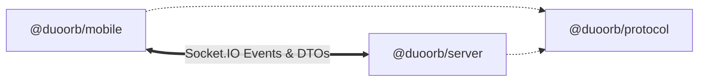

# @duoorb/protocol

Shared contract definitions, Data Transfer Objects (DTOs), and WebSocket event signatures for DuoOrb.

---

## 1. Role in the Monorepo

`@duoorb/protocol` ensures type-safety between the mobile client (`apps/mobile`) and the authoritative server (`apps/server`).



---

## 2. Shared Contracts & Types

- **User & Social DTOs:**
  - `UserProfileDto`: Player ratings (1v1, 4p), match statistics, online/playing status, cosmetics.
  - `FriendDto`, `FriendRequestDto`: Real-time friends lists and presence.
- **Matchmaking & Rooms:**
  - `MatchmakingQueueDto`: Ranked queue request with mode and rating parameters.
  - `RoomDto`, `RoomSlot`: 6-letter private room state, host indicators, and ready status.
- **Real-Time Gameplay Packets:**
  - `ClientActionPayload`: Move/wall action submission with sequence numbers.
  - `GameStateSyncPayload`: Authoritative board state broadcast.
  - `MatchResultPayload`: Match completion summary with rating adjustments ($\Delta R$) and outcome.
- **Error Types:**
  - Standardized error codes for invalid moves, illegal wall placements, room collisions, and timeout resignations.

---

## 3. Building

```bash
npm run build --workspace=@duoorb/protocol
```
